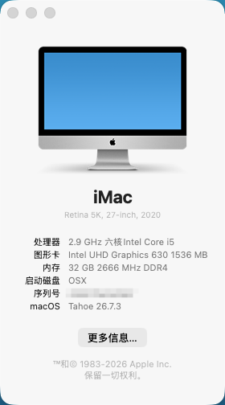

# MacOS 26.7.3 EFI | i5-10400 | H510M-K

黑苹果 **Intel Core i5-10400 + ASUS PRIME H510M-K** 的 MacOS 26.7.3 EFI 配置。

本项目记录了在 ASUS PRIME H510M-K 主板上，使用 Intel UHD 630 核显成功安装并运行 macOS Tahoe 的完整实践经验，包含 EFI 配置、BIOS 设置、硬件兼容性测试以及核显显示问题的解决方案。

**本 EFI 基于实际硬件测试，不保证适用于其他型号的主板及硬件配置。**

## 效果展示



## 硬件配置

| 硬件 | 型号 / 参数 |
|---|---|
| CPU | Intel Core i5-10400 @ 2.90GHz |
| GPU | Intel UHD Graphics 630 |
| Motherboard | ASUS PRIME H510M-K |
| Memory | Kingston DDR4 2666MHz 16GB × 2 |
| RAM | 32GB |
| BIOS | American Megatrends 1601 |
| BIOS Date | 2022/05/07 |
| BIOS Mode | UEFI |
| SMBIOS | 3.3 |
| macOS | Tahoe 26.7.3 |

**主板信息：**
- Manufacturer: ASUSTeK COMPUTER INC.
- Product: PRIME H510M-K
- Revision: Rev 1.xx
- Platform: Desktop

## 硬件驱动与兼容性

以下内容均为本人实际测试结果。

| 硬件 | 状态 | 说明 |
|---|---|---|
| CPU | 正常 | 睿频加速、休眠、核心识别均正常 |
| Intel UHD 630 | 正常 | 3D 加速、显卡驱动、显存识别正常 |
| HDMI | 正常 | 视频输出正常 |
| VGA | 不可用 | 无法正常输出画面 |
| USB 2.0 | 正常 | 可以正常使用 |
| USB 3.0 | 部分正常 | 主板后置两个 USB 3.0 接口可用，前置接口仅识别为 USB 2.0 |
| Ethernet | 正常 | Intel I219-V，有线千兆网络正常 |
| Onboard Audio | 未测试 | 没有外接喇叭，未进行测试 |
| HDMI Audio | 未测试 | 没有外接喇叭，未进行测试 |

**已知限制：**
- 主板 VGA 接口无法正常输出 macOS 画面。
- 前置 USB 3.0 接口目前仅能以 USB 2.0 速度工作。
- 板载声卡及 HDMI 音频尚未进行实际测试。

## 如何使用 EFI

### 1. 准备安装盘

建议使用 [1401 项目](GitHub地址待补充) 创建 macOS 安装启动盘。

按照原项目的教程完成以下操作：

1. 扫描当前硬件。
2. 创建 macOS 安装启动盘。
3. 根据教程修改 BIOS 设置。

在正式使用 1401 安装盘启动之前：

**使用本项目中的 `EFI` 文件夹，替换安装启动盘中原有的整个 `EFI` 文件夹。**

请确保 EFI 目录结构完整，不要只替换其中的部分文件。

### 2. BIOS 设置

本项目使用 ASUS PRIME H510M-K 主板。

开机按 `F2` 进入 BIOS，然后按 `F7` 切换至 Advanced Mode。

可以按 `F9` 搜索对应选项，逐项核对以下设置：

| BIOS 选项 | 设置 | 说明 |
|---|---|---|
| Secure Boot | Disabled | 关闭安全启动 |
| CSM | Disabled | 关闭 Legacy 兼容启动 |
| Fast Boot | Disabled | 关闭快速启动 |
| Above 4G Decoding | Enabled | 开启 4G 地址空间解码 |
| XHCI Hand-off | Enabled | 开启 USB 控制器交接 |
| DVMT Pre-Allocated | 1024M | 核显预分配显存设置为 1024MB |
| iGPU | Enabled | 强制开启集成显卡 |
| VT-d | Disabled | 关闭虚拟化 I/O 定向技术 |
| SATA Hot Plug | Disabled | 关闭 SATA 接口热插拔 |

**SATA 特别说明：**

- SATA 2 接口必须关闭。
- 其他 SATA 接口根据实际使用需求启用。
- 如果没有使用任何 SATA 存储设备，建议直接禁用 SATA 控制器及相关接口。

完成设置后，保存 BIOS 配置并退出。

### 3. 启动安装程序

完成 BIOS 设置和 EFI 替换后，使用 1401 安装盘启动电脑，按照原项目的教程执行安装命令。

如果执行过程中出现报错，或者某个步骤长时间卡住：

直接拍摄屏幕照片，`config.plist`一起提交给 AI Agent根据实际配置和日志分析问题。

---

## 安装过程中的常见问题

### 问题一：Apple Logo 出现之前，显示器提示无信号

**故障表现：**

执行完安装盘中的命令后，电脑进入下一阶段，但 Apple Logo 尚未出现，显示器便提示无信号。

此时主机仍在运行。

再进一步，就是在使用-igfxvesa参数的时候，输出正常，但是显卡无了。

在不使用-igfxvesa的时候，显卡正常，但是输出无了。

MacOS日志提示为找不到插入的显示器。

**原因及解决方法：**

首先检查视频输出接口。

本主板的 VGA 接口在 macOS 下无法正常输出画面，因此必须使用 HDMI 数字视频信号。

如果显示器没有 HDMI 输入接口，可以使用 HDMI 转 VGA 转接器。

本人使用的转接器如下：


理论上其他兼容的 HDMI 转 VGA 转接器也可以使用，但转接器存在一定的兼容性差异。

**最稳妥的方式仍然是 HDMI 直连显示器。**

如果确认使用的是 HDMI 输出，问题依旧，可以继续进行以下排查。

### 问题二：如何判断系统是否已经启动？

如果显示器始终提示无信号，请耐心等待约 3 分钟。

随后按下键盘上的 `Caps Lock` 键，观察键盘指示灯是否发生变化。

- 如果指示灯可以正常切换，说明系统很可能已经启动，只是视频输出出现了问题。
- 如果指示灯没有变化，则不能仅凭这一现象判断系统是否启动，需要继续检查启动日志。

### 问题三：使用 -igfxvesa 参数临时解决显示输出问题

在排查显卡问题之前，首先需要明确当前处于哪个安装阶段。

OpenCore 启动过程中主要涉及以下几个阶段：

1. **1401 安装盘**：执行安装环境中的脚本和命令。
2. **下载安装文件**：下载 macOS 安装文件，并准备安装环境。
3. **macOS Installer**：通过 OpenCore 启动项进入 macOS 安装程序，执行系统安装。
4. **OSX**：安装完成后，从本地磁盘启动已安装的 macOS 系统。

如果还没有成功进入最终的 `OSX` 阶段，可以尝试在 `config.plist` 的 `boot-args` 中添加：

```text
-igfxvesa
```

该参数会禁用 Intel 核显的正常图形加速，使系统使用基础显示模式启动。

此时：
- 可以暂时绕过部分核显初始化问题。
- 可以使用基础显示输出完成系统安装。
- VGA 和 HDMI 在基础显示模式下可以正常输出。
- 核显 3D 加速不可用，系统画面可能比较卡顿。

**建议：**

先使用 `-igfxvesa` 完成 macOS 安装，并成功创建本地用户账户。

此时不要急于追求显卡加速，优先保证系统可以正常启动。

### 问题四：UHD 630 显卡识别正常，但没有 3D 加速

在使用 `-igfxvesa` 成功进入 macOS 后，可能会发现：

- 系统能够识别 Intel UHD 630。
- 显卡没有正常启用 3D 加速。
- 系统画面明显卡顿。
- 显存可能仅显示为 7MB 左右。

这属于基础显示模式下的预期现象。

对于 ASUS PRIME H510M-K，本人遇到的问题是：需要针对实际显示器注入 EDID 信息，才能解决 UHD 630 的显示输出问题。

可以参考以下项目：

[UHD630-500series-display-fix](https://github.com/ailtonvieira07/UHD630-500series-display-fix)

#### 第一步：获取显示器 EDID

在 Windows 系统中，以管理员身份打开 PowerShell，执行以下命令：

```powershell
Get-ChildItem 'HKLM:\SYSTEM\CurrentControlSet\Enum\DISPLAY' -Recurse -ErrorAction SilentlyContinue |
Where-Object { $_.PSChildName -eq 'Device Parameters' } |
ForEach-Object {
    $p = Get-ItemProperty $_.PSPath
    if ($p.EDID) {
        "路径: $($_.Name)"
        "EDID: $([BitConverter]::ToString($p.EDID).Replace('-',''))"
    }
}
```

该命令会扫描 Windows 注册表中的显示器信息，并提取 EDID 数据。

请保存命令输出的内容。

#### 第二步：注入显示器信息

将以下资料一起交给 AI Agent：

1. 上一步获取的显示器 EDID。
2. [UHD630-500series-display-fix 项目](https://github.com/ailtonvieira07/UHD630-500series-display-fix)。
3. 当前正在使用的 `config.plist`。

要求 Agent 参考该项目，在 `config.plist` 的 Intel UHD 630 Framebuffer 配置中，注入当前显示器对应的 EDID 信息。

**注意事项：**

- 建议同时检查并配置 `con0`、`con1`、`con2`。
- 本主板的 HDMI 接口对应 `con2`。
- 应以 HDMI 数字信号为准。
- VGA 属于模拟视频信号，不应将其作为本次配置的目标输出接口。
- EDID 必须使用自己显示器实际读取到的数据，不要直接照搬其他人的配置。

#### 第三步：移除临时启动参数

完成 Framebuffer 和显示器信息注入后：

打开 `config.plist`，找到 `boot-args`，删除之前添加的：

```text
-igfxvesa
```

保存配置并重新启动 macOS。

如果配置正确，此时应该可以实现：

- UHD 630 正常驱动。
- 显示器正常输出画面。
- Intel 核显 3D 加速正常。
- 显存容量正确识别。

至此，核显驱动问题基本解决。

#### 第四步：如果修改后仍然无法正常显示

不要着急反复修改其他配置。

可以按照以下顺序排查：

1. 强制重启电脑。
2. 将 `-igfxvesa` 重新添加到 `boot-args`。
3. 确认系统能够重新进入基础显示模式。
4. 检查 Framebuffer 注入的数据是否正确。
5. 检查 HDMI 对应的 Connector 配置。
6. 收集最新启动日志，再交给 Agent 分析。

**建议保留一份可以正常启动的 EFI 备份。** 这样即使显卡配置出现问题，也可以恢复到基础显示模式。

---

## 本人使用的显示器

| 项目 | 参数 |
|---|---|
| Manufacturer | ASUS |
| Model | VS228 |
| Resolution | 1920 × 1080 |
| Refresh Rate | 60Hz |
| HDMI Input | 无 |

本人使用的是 ASUS VS228 显示器，通过 HDMI 转 VGA 转接器连接主板。

如果你使用相同的显示器及转接方式，可以优先尝试直接使用本项目 EFI。
---

## 注意事项

1. 本项目 EFI 仅针对本人实际硬件配置进行测试。
2. 不同主板、BIOS 版本、显示器及硬件组合可能需要调整 `config.plist`。
3. 不建议直接照搬 SMBIOS、EDID 或 Framebuffer 配置。
4. 如果遇到USB不认，或者USB3.0全部失效只认USB2.0的情况，在进入MacOS后，运行1401.app，重新跑一遍USB映射，然后map一下即可。

## Credits

感谢以下项目及社区提供的技术支持：

- [1401 项目](GitHub地址待补充)：macOS 安装环境及启动盘构建。
- [UHD630-500series-display-fix](https://github.com/ailtonvieira07/UHD630-500series-display-fix)：Intel UHD 630 显示输出问题的参考解决方案。
- [OpenCore](https://github.com/acidanthera/OpenCorePkg)：Bootloader。

---

**如果这份 EFI 对你有所帮助，欢迎 Star 本项目。**
